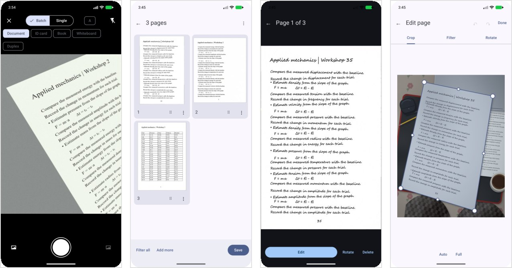
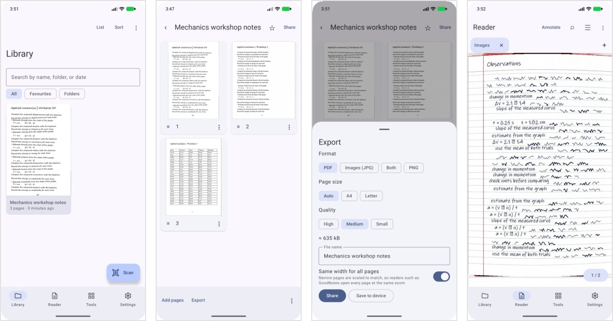
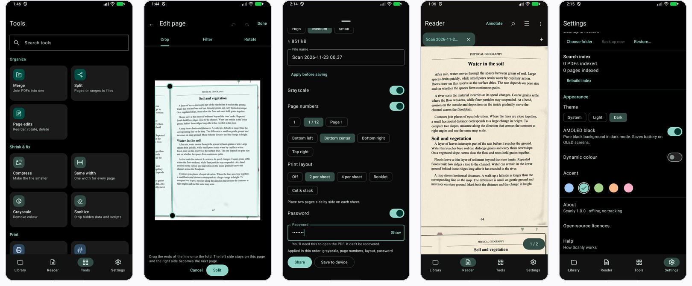
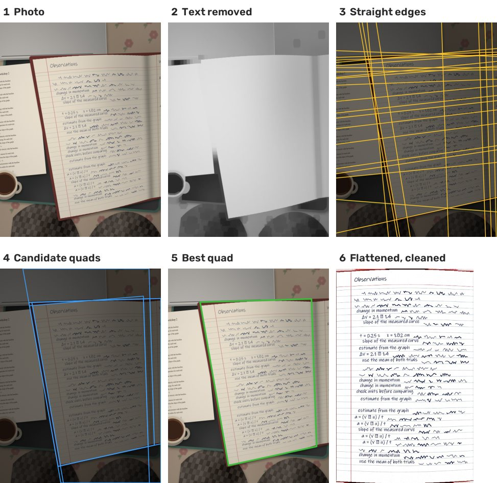
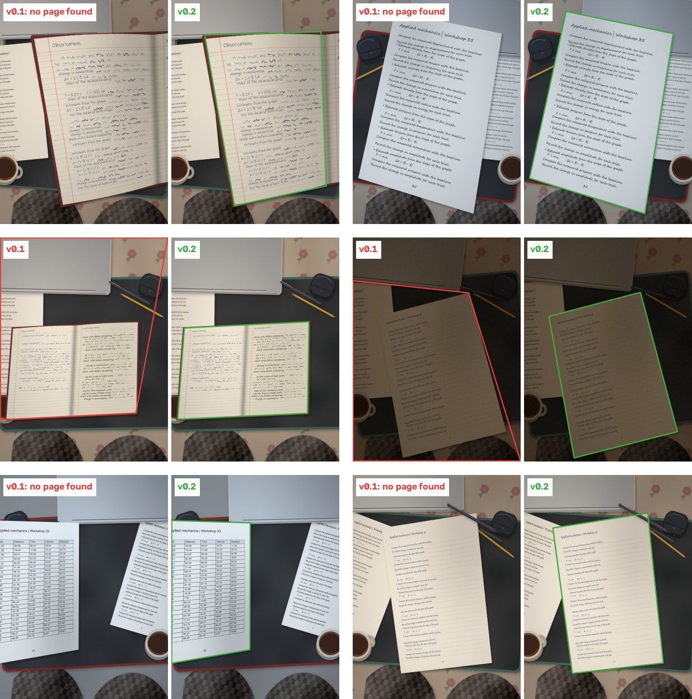
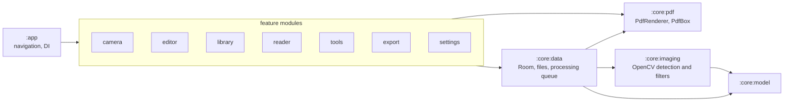

<div align="center">

# Scanly

**An offline document scanner and PDF toolkit for Android.**

No account, no cloud, no ads, no watermark. Your pages stay on your phone.




</div>

## What it does

Scanly turns phone photos of paper into clean, flat pages, keeps them in a local library, and exports PDFs or images. A home screen puts scanning and the common tools one tap away; a built-in reader and fourteen PDF tools cover the rest of your paperwork.

| | |
|---|---|
| **Home** | Editable shortcut tiles (Scan, Import, Images → PDF, Open PDF, Merge, Compress, ID card, Sign PDF, Extract text and more), recent documents, one big Scan button |
| **Scan** | Batch or single capture, live page outline, auto-capture, gallery import, share-to-scan, Quick Settings tile; a steady outline at the shutter skips the slow page search |
| **Clean up** | Auto-crop, perspective fix, Document / Colour / B&W / Grayscale / Whiteboard filters (Document keeps shaded boxes and coloured labels as printed), shadow and glare fixes, auto-deskew, coloured-ink removal |
| **Special modes** | ID card (front and back on one A4 page, editable sides, stacked or side by side, true size), Book (a spread becomes two pages), Split in two by hand along a slanted fold, Whiteboard, two-sided batches, auto-split at blank sheets |
| **Text** | Offline text recognition in English and Bengali (Tesseract): copy text from a page, search your library by the words on scanned pages, export searchable PDFs |
| **Library** | Folders, tags, favourites, search by name, folder, tag, date and text inside PDFs and scans, swipe to share or delete (with Undo), recycle bin, app lock, plain-file backup and restore |
| **Reader** | Tabs, search, select and copy, links, bookmarks with chapter suggestions, crop margins, side-by-side pages, pen and highlighter annotations, signatures (draw once, place anywhere, also on scanned pages), a page tag while scrolling, full-screen lock, page tones (Night, Sepia, Warm) |
| **Export** | PDF, JPG or PNG for a whole document; stack steps in any order on the way out (same width, grayscale, compress, page numbers, print layout, clean metadata, searchable text), then an optional password; Share or Save image for one enhanced page |
| **Look** | Material 3 Expressive; light, dark or system theme, AMOLED black, Material You colours or one of five accents, in-app Help, one-time tips |
| **Tools** | Merge, split, page edits, compress, same page width, print layouts (N-up, booklet, duplex cut orders), page numbers, password, metadata, sanitize, grayscale, images ↔ PDF, batch runs; grouped, searchable, pinnable, with recent outputs |

## Screenshots



Tools, splitting a two-page photo by hand, tools stacked onto an export, the reader in Sepia, and AMOLED black with a teal accent:



## Page detection

A phone photo of notes tends to hold more than one sheet: open notebooks, a laptop, a desk mat, pens and other paper in the same frame. Scanly finds the page with straight-edge candidates and a paper-likeness score, then flattens it.



The same photos with the v0.1 detector (red) and the current one (green):



| Test set | v0.1 | v0.2 |
|---|---:|---:|
| Synthetic scans (58) | 58 | 58 |
| Cluttered desk scenes (56) | 1 | 40 |
| Real phone photos of notes (27) | about half | 26 |

From v0.3 the desk set grew to 84 scenes, adding book close-ups, binding shadows, hand shadows and pages touching the photo edge. Version 1.0 finds 61 of the 84. When a crop is off, the editor's handles fix it in a few seconds.

With an open notebook, Scanly crops the whole spread when both pages are in the frame. When one page runs off the edge, it crops the page you can see in full. You can drag any corner in the editor; a magnifier follows your finger.

[How detection works →](docs/detection.md)

## Install

Scanly isn't on the Play Store. Download the APK from [Releases](../../releases) and open it on the phone. Android asks you to allow installs from that app once.

Versions 0.1 to 0.4 were pre-releases tested on a real phone. 1.0.0 is the first stable release. Each update installs over the last one and keeps your library. From 1.1.0, Settings → Updates checks for a new version and installs it for you. From 1.1.4 an update downloads only what changed when the release has a patch for your version (usually 1 to 5 MB).

## Privacy

- The only network request is the update check: Scanly asks GitHub whether a newer release exists and downloads it when you tap install. Turn the automatic check off in Settings → Updates. Nothing about you or your documents is sent.
- No analytics, ads, accounts or AI services.
- Exports carry no watermark or branding. PDF metadata holds only the title and producer.
- Photos stay as you took them. Edits write a processed copy, so you can re-crop or change a filter later.

## Build from source

You need JDK 21, the Android SDK (platform 37.1) and NDK 30.0.16248370.

```bash
./gradlew assembleDebug             # debug APK, arm64 + x86_64
./gradlew testDebugUnitTest lint    # unit tests and lint
bash tools/check.sh                 # full gate: build, tests, lint, imaging regressions, network guard
```

Release builds read signing details from a local `keystore.properties` (not in the repository) and produce an arm64-only APK of about 36 MB. OpenCV comes from a slim build in `third_party/opencv` (see its README).

## Project layout



| Path | Contents |
|---|---|
| `app/`, `core/`, `feature/` | The Android app |
| `tools/imaging-lab/` | Python reference for every image algorithm; the Kotlin port must match it |
| `tools/fixtures/` | Generators for the labelled test photos and PDFs in `test-data/` |
| `tools/pdf-fixwidth/` | Desktop tool that gives every PDF page the same width |
| `docs/` | Requirements, architecture, testing, roadmap |

## Documentation

- [Requirements](docs/01-PRD.md): what v1 includes and leaves out
- [Architecture](docs/02-architecture.md): modules, data model, image pipeline, reader
- [Page detection](docs/detection.md): the algorithm, test sets and known limits
- [Dependencies and licences](docs/03-dependencies-licensing.md): Apache-2.0, MIT and BSD only
- [Testing](docs/06-testing-strategy.md): fixtures, parity tests, emulator checks
- [Roadmap](docs/05-roadmap-sessions.md) and [progress tracker](tracker.md)

## Licences

Scanly uses OpenCV, PdfBox-Android, AndroidX, Coil and a few other libraries, all under Apache-2.0, MIT or BSD. The full list with versions is in the app under Settings → About → Open-source licences, and in [docs/03](docs/03-dependencies-licensing.md).
