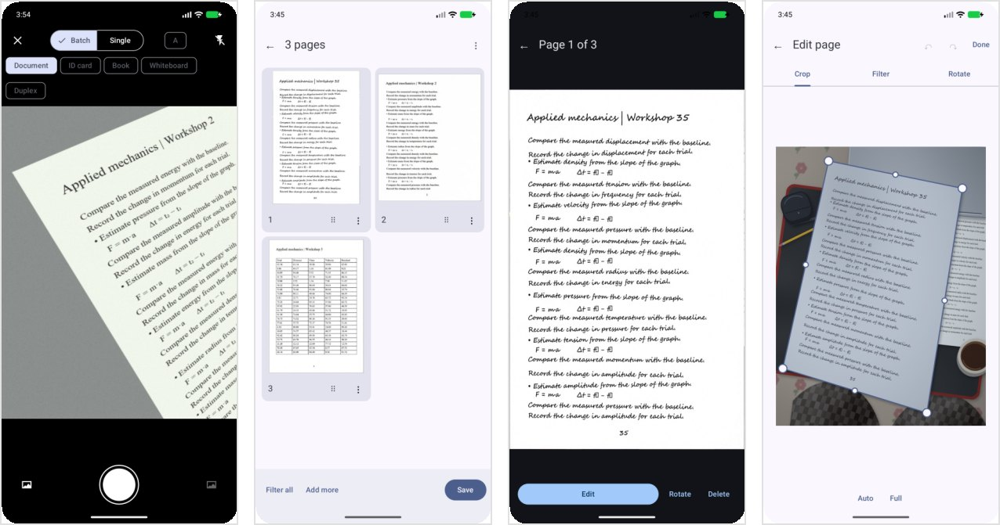
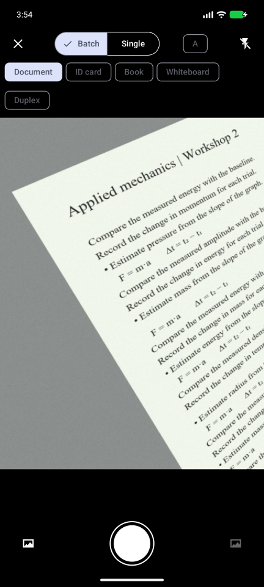
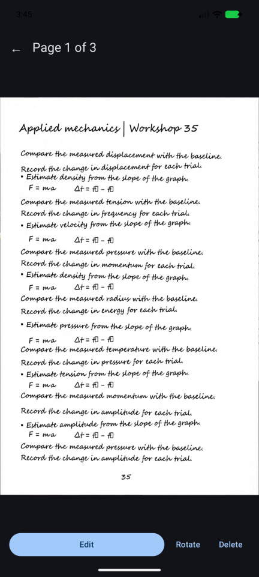
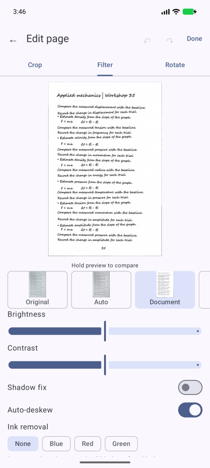
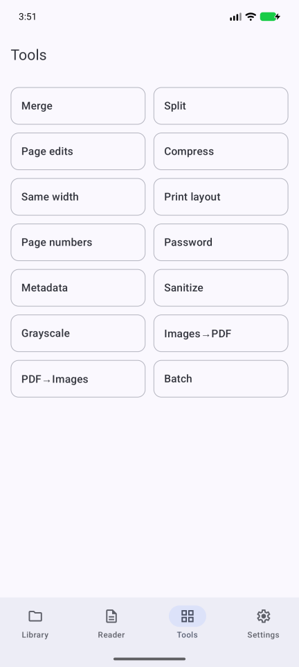

# Scanly documentation

## Start here

| Document | Read it for |
|---|---|
| [Requirements](01-PRD.md) | Every v1 feature with its ID (SC-, DM-, RD-, PT-, EX-), plus what v1 leaves out |
| [Architecture](02-architecture.md) | Modules, data model, image pipeline, PDF layer, reader design; section 8 lists what changed while building |
| [Page detection](detection.md) | How Scanly finds the page in a photo, the test sets and the known failures |
| [Testing](06-testing-strategy.md) | Fixtures with ground truth, Python/Kotlin parity tests, emulator and phone checks |
| [Dependencies and licences](03-dependencies-licensing.md) | Each library, its version and licence; what we refuse to use and why |

## Screens

| Document | Read it for |
|---|---|
| [Screens and navigation](04-screens-navigation.md) | Screen-by-screen spec and the navigation graph |

<table>
<tr>
<td></td>
<td></td>
<td></td>
<td></td>
</tr>
<tr>
<td align="center">Camera</td>
<td align="center">Page viewer</td>
<td align="center">Filters</td>
<td align="center">PDF tools</td>
</tr>
</table>

## Planning record

These files show how the project was planned and built. They describe intent at the time of writing; the code and the documents above are current.

| Document | Contents |
|---|---|
| [Roadmap](05-roadmap-sessions.md) | Phases S0 to P8 with session estimates |
| [Risks and decisions](07-risks-open-questions.md) | Technical risks and the gate decisions D1 to D15 |
| [Desktop setup](08-desktop-setup.md) | Toolchain installation for the build machine |
| [Session prompts](09-session-prompts.md) | Prompts used to run each build session |
| [Brainstorm, part 1](00-chatgpt-brainstorm-transcript.md) and [part 2](00b-chatgpt-pdf-tools-transcript.md) | The original idea conversations |
| [Progress tracker](../tracker.md) | Phase checklist and a log of every session |
