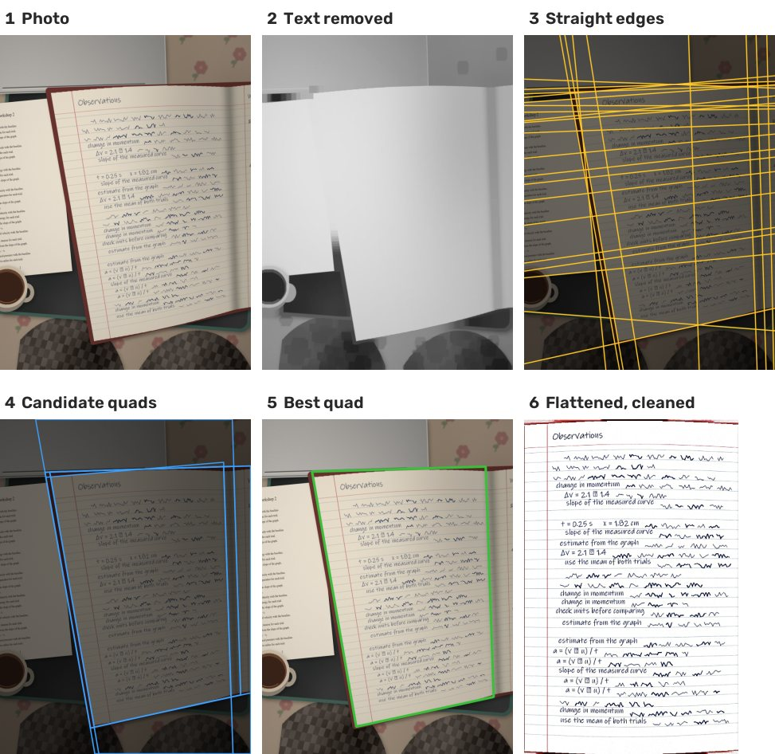
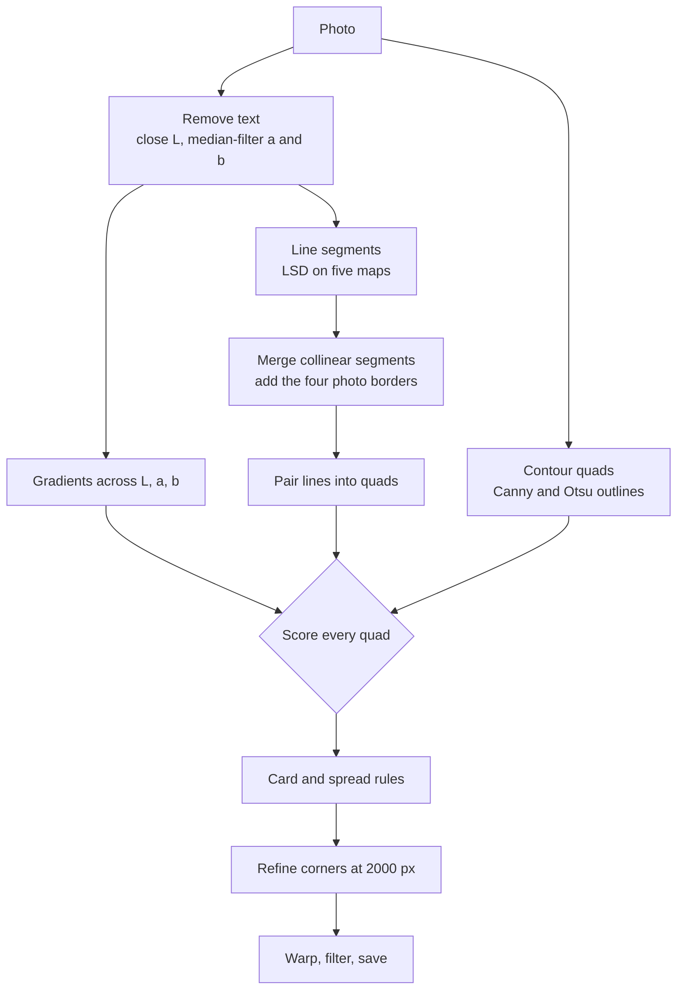
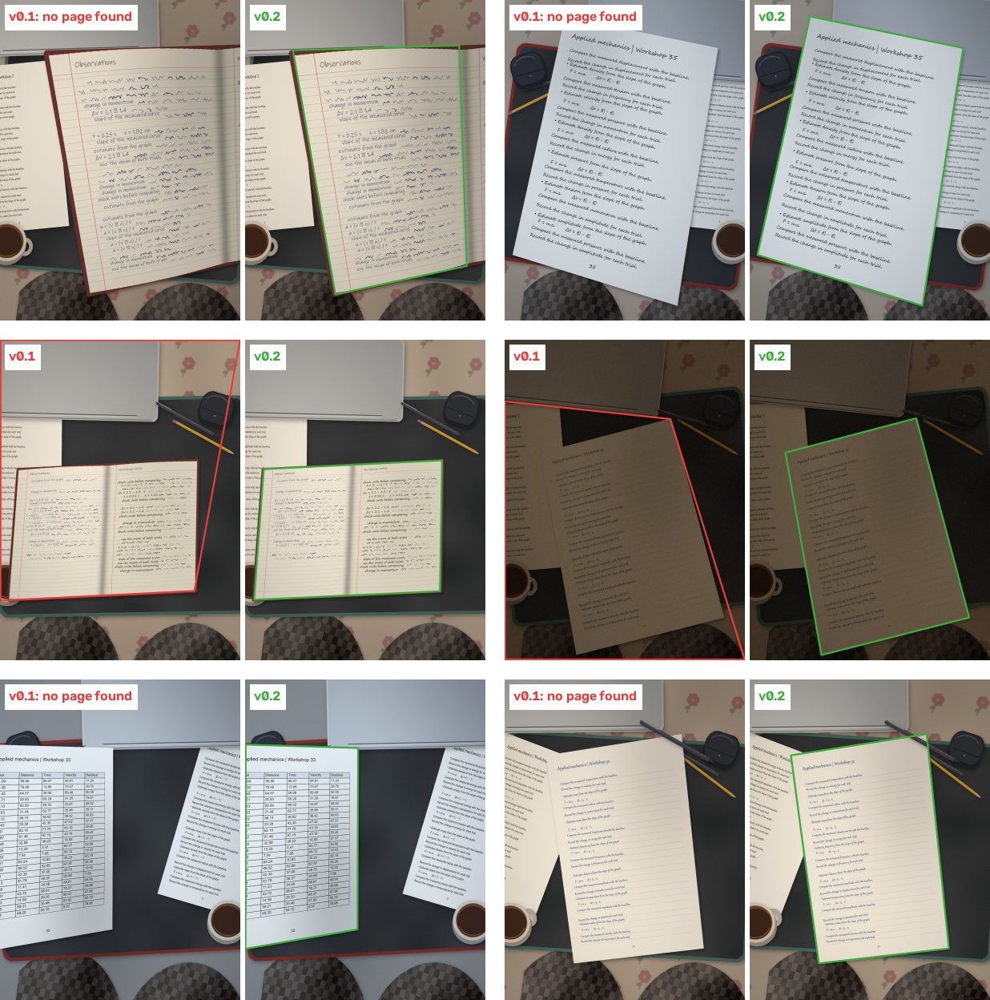

# Page detection

Scanly looks for the page in every photo and crops it to a flat rectangle. This page describes how the detector works, how we test it and where it still fails.



## Steps

The detector runs on a copy of the photo scaled to 1000 px on the long side. The camera overlay runs a lighter version on 480 px preview frames.



1. **Remove text.** A morphological close on the lightness channel fills in ink, so a page with writing turns into a smooth bright region. A median filter on the two colour channels removes thin coloured strokes such as the red margin line and blue ruling of a notebook.
2. **Find straight edges.** OpenCV's line segment detector runs on the cleaned lightness, both colour channels, plain grey and a contrast-boosted grey. Segments with the same angle and offset merge into one line. The four photo borders join the list, so a page cut off by the frame still has four sides.
3. **Build candidates.** Every pair of near-horizontal lines with every pair of near-vertical lines gives a quad. Quads with bad angles or tiny areas drop out. The detector keeps the 60 with the strongest edges and adds the outlines found by the older contour method.
4. **Score.** Each quad gets one number from five measures:

   | Measure | Question it answers |
   |---|---|
   | Edge support | Does a strong gradient run across each side? Photo-border sides count as neutral. |
   | Page-likeness | Is the inside one bright, neutral, even tone over most of its area? |
   | Inner rim | Is the strip inside each side the same paper as the middle? A side drawn on the desk beyond the page fails here. |
   | Coverage | Does the quad cover the whole page-toned region it sits on? This rejects a strip between the top edge and a ruled header line. |
   | Brightness | Is the inside brighter than the photo as a whole? |

   Small terms favour larger quads near the middle of the photo.
5. **Apply the card and spread rules.**
   - A card's white body under a coloured header can outscore the card. If a quad encloses the winner with edges at least as strong and the band it adds is page-toned, the detector takes it.
   - An open notebook has a fold down the middle. When both pages fit in the photo, the detector grows a single page to the whole spread. When one page is clearly cut by the frame, it keeps the other one.
6. **Refine.** For each side, the detector finds the strongest edge point along short normals in a 2000 px copy, fits a line through them and intersects neighbouring lines for sub-pixel corners.

ID card mode adds an aspect-ratio prior (85.6 × 54 mm) and skips the rim test, because cards carry photos and coloured bands.

## Live overlay

Camera analysis frames are 640 × 480 and carry brightness only. The overlay skips the contour pass, finds lines on two maps instead of five, keeps 30 candidates and computes page statistics at 240 px. A median smoother over recent frames steadies the outline and reports stability, sharpness and a 16 × 16 fingerprint to the auto-capture controller.

## How we test it

We prototype every change in Python under `tools/imaging-lab/` and port it to Kotlin only after the contact sheets look right. An instrumented test then checks that the Kotlin corners match the Python reference within 3 px on 19 golden photos, and the live corners within 1.5 px.



| Set | Photos | What's in it | v0.1 | v0.2 |
|---|---:|---|---:|---:|
| `scanner/synthetic` | 48 | Single sheets with skew, shadow, glare, low light, busy backgrounds | 48 | 48 |
| `special` | 10 | ID cards, book spreads, whiteboards | 10 | 8 (10 in ID card mode) |
| `scanner/desk` | 56 | Notebooks, laptops, desk mats, pens, clipped and covered pages, dim light | 1 | 40 |
| Private phone photos | 90 | The author's notes and a friend's notebooks | judged by eye | judged by eye |

A synthetic or special photo counts as a hit when every corner lands within 2% of the image diagonal of the truth. Desk scenes use the mean corner error under 3%. `tools/check.sh` fails if desk hits drop below 37.

Reproduce the numbers:

```bash
python tools/imaging-lab/run_regression.py              # synthetic + special
python tools/imaging-lab/run_regression.py --set desk   # desk scenes, add --sheet for a contact sheet
```

## Known limits

- **White on white.** A white sheet on a white table or on other paper, with no shadow along the edge, gives no gradient to follow. All seven `white-on-light` desk scenes still miss.
- **Steep corners out of frame.** A page tilted far enough that a corner leaves the photo can fall back to the full image.
- **Cards outside ID mode.** Two of the four test cards lose their coloured header in Document mode. ID card mode finds all four.
- **Curled pages.** The detector fits straight lines. A bowed notebook edge gets the chord between its corners, and the page isn't dewarped.
- **Speed.** A full detection takes about one second on the x86_64 emulator. It runs in the background after capture, so you can keep shooting. Pixel timings are still to be measured.

When the detector finds no page, the editor opens with the full photo and you drag the corners yourself. **Auto** in the crop tab runs detection again.
